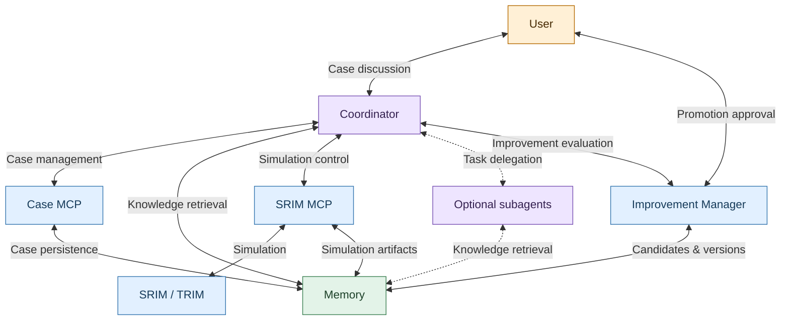
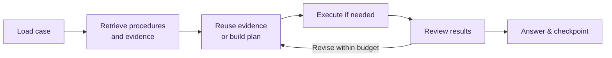

# Project implementation checklist

Updated: 2026-10-16

Build an auditable SRIM/TRIM system with durable execution, reusable scientific evidence and evaluated improvements. Software success is CHECKED; scientific acceptance is deferred. This file owns acceptance/backlog items; README.md owns usage and HANDOFF.md owns current evidence, constraints and stopping state. Recording a task does not authorize executing it.

## Completed foundation

| Status | Delivered behavior | Retained evidence |
|---|---|---|
| [x] | Installable package, CLI, explicit configuration and local stdio MCP routing for ten SRIM tools | pyproject.toml, configs/application.toml, interfaces/, tests/interfaces/; local registration is ignored by Git |
| [x] | Explicit version-1 capability inputs/results, units, source provenance and physical/execution hashes | capabilities/{stopping_range,trim}/, domain/specifications.py, backend input/output tests |
| [x] | Direct SR Module/TRIM backends, shared process dispatch, exclusive worker lock, sibling workspaces, copied-once support and stale-output cleanup | backends/{sr_module,trim}/, execution/, backend execution tests |
| [x] | SQLite metadata/events/results, coherent reads, manifests, sealed-attempt linkage and verified retrieval | storage/, tests/{storage,execution,interfaces}/ |
| [x] | SR interval-table parsing; TRIM summary, seven profile and seven detail families with bounded retrieval | Backend output tests/fixtures; native integration methods |
| [x] | Input/session/storage error handling, worker diagnostics and completed-result warnings | tests/interfaces/test_{cli,mcp}.py, tests/execution/test_workers.py, backend input tests |
| [x] | Native all-mode and CLI/MCP coverage, separate-runtime concurrency and archive isolation | Five native methods; latest results and exact limits in HANDOFF.md |
| [x] | Continuity rules, docstring conventions, application-only cleanup and Git setup with project-specific ignore rules and public GitHub origin | AGENTS.md, HANDOFF.md, .gitignore; https://github.com/c-earth/agentic_srim |
| [x] | Portable project Git rules and host setup with committed-checkpoint preservation instructions | .codex/rules/git.rules and .agents/skills/ trackable; AGENTS.md uses clone-relative paths, README.md owns onboarding. Verified 10 shared paths unignored, six local paths ignored, exactly three new setup files exposed, no absolute machine paths in portable setup and 476 config/test paths unignored; diff check passed. Prior 21 execpolicy checks remain; trusted-project restart/fresh-clone execution unverified. Commit/push now authorized. |
| [x] | Portable Windows onboarding, capability guide, CLI walkthroughs and generic/Codex MCP configuration | README.md audit 2026-10-16: complete three-server config, method verification and standalone Case/Analysis setup. All 13 PowerShell blocks, two JSON/two TOML blocks, local links/anchors, 33 tool names, two fixture requests and three CLI helps passed; no simulation/method job executed. |
| [x] | Independent Case MCP with durable revisions/retries, search, branching, artifact links and readable overviews | src/case/, configs/case.toml, tests/cases/; 27 non-native Case tests passed again on 2026-10-16. Desktop discovery exposes ten tools; live list/search succeeded against the empty store |

Latest software evidence (2026-10-16): 125 component tests ran (120 passed/five native skipped), plus 19 Analysis tests passed. Includes captured SR/TRIM export checks, all thirteen Analysis tools over stdio, supervised Python descendants/crash recovery, reuse/concurrency, Case linkage and rendering. Three built-in version-1 methods have retained current-environment verification records. Historical native evidence remains 2026-10-15: five methods/34 CHECKED calculations; scientific acceptance remains deferred. HANDOFF.md owns exact verification evidence/limits.

## Open acceptance backlog

Operational-first direction (2026-10-16): the user requested a usable Case → SRIM → Analysis/plots → saved-answer path and deferred patching missing parts until another request. The Windows Analysis delivery, optional plotting installation, local MCP registration and non-native verification are complete below. Full acceptance/hardening, scientific validation, native runs, deletion/reset and broader workflow/Memory/Improvement work remain deferred. Later requests authorize temporary skills, portable Codex setup, README audit/verification and committing/pushing the delivery; broader application implementation/testing remains stopped.

Branch (2026-10-16): `codex/case-mcp` created from `main`, preserving existing documentation changes; subsequent user approval authorized the Case delivery below.

### Delivery order and architecture

Agreed: the host owns reasoning; a host workflow guides it, a separate case-management MCP persists validated records, and SRIM MCP retains calculation operations/archives. Human approval is required to promote workflow, skill or subagent changes.

### Approved architecture map (2026-10-16)

User approved this final relationship map and requested an implementation handoff. It supersedes earlier role-heavy diagrams and request/response edge labels. Labels describe the relationship; arrowheads indicate two-way interaction, not permission or execution sequence. Dashed connections are optional. For further design, recommend one connection at a time and draw only when requested.

- Coordinator handles planning, research, analysis and case ownership using reusable procedures. Subagents are optional, bounded and evaluated for benefit/cost; no permanent Planner/Researcher/Reviewer/Analyst roster. Their Memory access is task-scoped/read-only; authoritative case writes go through Case MCP. Direct peer messaging is available in this session, not verified across all hosts.
- Memory represents all persistent cases, procedures, references, evidence, artifacts and versions, with record types/provenance preserved; it does not mandate one database/folder or mean model context/RAM. Case MCP owns case mutations; SRIM MCP owns run archives; Improvement Manager owns candidates/evaluations/promotion records. Physical layout and access/search contracts remain open. Start with structured catalog/applicability rules; add RAG only when justified.
- Improvement Manager requests human approval of a specific candidate version; the interaction may use Coordinator chat. Approval/rollback are retained; no automatic promotion or silent case-version migration. The manager's package/API/job mechanism remains undecided, not necessarily another MCP server or always-running daemon.
- Keep node names and service-worker coloring exactly as shown; omit bracketed roles, CPU/RAM and model-compute nodes. These are display choices; actual execution workers remain. Architecture approval authorizes this plan/handoff, not implementation, native runs or scientific acceptance.

Coordinator workflow is separate from the architecture map:

Capability/input gaps require clarification or a recorded limitation; execution needs applicable authorization and remaining budget. Scientific reuse requires accepted evidence. Budget exhaustion and scientific acceptance are distinct; useful new procedures enter the evaluated, human-approved improvement process.

| Phase | Deliverable / dependency |
|---|---|
| 1 | Case identity, lifecycle, ownership and versioned contracts; resolve layout/service boundaries first |
| 2 | Case MCP persistence, search, history, readable artifacts and older-case continuation; depends on 1 |
| 3 | Capability discovery and workflow-first host coordination, with bounded skills/delegation; depends on 1–2 |
| 4 | Source ingestion, evidence applicability, numerical retrieval and answer lineage; schemas start in 1 and integrate with 2–3 |
| 5 | Case-level budgets, deterministic jobs and end-to-end evaluation; enforcement precedes autonomous multi-run execution |
| 6 | Reusable-plan improvement pipeline, evaluated versions and human-approved promotion; depends on evidence/accounting/evaluations |
| Later | Additional workers, search methods, adaptive sampling and surrogates only when justified |

Scientific reference selection gates scientific acceptance, reference reports and scientific promotion claims; it does not block non-native case-management development. Software checks can use mocks/fixtures and must retain their limitations. Existing foundation/operations gaps below remain open alongside these phases.

### Scientific reference and planning

- [ ] Confirm a scientific reference case, ion/material sources, comparison metrics, accuracy targets, and scientific runtime budget before choosing scientific defaults. Explicitly deferred by the user on 2026-10-15. All scientific request fields remain required; `tests/sr_module/fixtures/request.json` copies the installed example solely for software regression. Operational bounds are explicit in `configs/application.toml`.

### Reliable simulation foundation

- [ ] Establish reproducible application dependencies. Implemented: no third-party core runtime dependencies; optional Matplotlib 3.10.8 plotting extra; setuptools 84.0.0 build pin; editable install and `pip check` passed. Documented in `README.md`. Clean-environment rebuild remains unexercised.
- [ ] Define typed, versioned domain schemas for materials, specifications, cases, campaigns, runs, attempts, analyses, evidence, and answers. Initial capability-local `Request`/`Element` and `Row`/`Table`, version-1 JSON contracts, units/normalization/sources, and invalid-input checks are implemented (`capabilities/stopping_range/{inputs,outputs}.py`, `tests/sr_module/test_{input,output,execution}.py`). Version-1 case records/narrative evidence/answers are implemented in src/case/records.py and tests/cases/; independent Analysis contracts are implemented in src/analysis/; richer scientific entities remain pending.
- [ ] Persist workflow states and bounded retry, timeout, cancellation, and recovery behavior. Implemented: SQLite events, bounded attempts, timeout/cancellation cleanup, recovery, and sealed-outcome reconciliation. Tests cover mocked timeout/cancellation cleanup, queued cancellation, and synthetic abandoned-attempt recovery. Hard worker termination/native process-tree supervision remains unverified; PID-recording gap documented in `README.md`. Retries share run ID.
- [ ] Implement scientific validation and convergence procedures. Deferred by user on 2026-10-15; no independent reference, numerical accuracy tolerance, uncertainty protocol, or evaluation suite chosen. Successful runs are `CHECKED`, not scientifically `ACCEPTED`.
- [ ] Deliver one scientifically validated CLI reference report. Acceptance: independent references and accuracy criteria pass with auditable source/run lineage. Historical software demonstrations were deleted under application-only cleanup and do not satisfy scientific acceptance.

### Phase 1 — Case contracts and ownership

Agreed service boundary (2026-10-16): Case MCP is a separate Python package/server with its own entry point/configuration and no SRIM installation required. User selected src/case/ and src/analysis/; preserve src/agentic_srim/ CLI/MCP. Use the existing distribution; separate distribution remains deferred. Analysis is implemented in src/analysis/ with its own configuration/entry point and no simulator installation required for numerical/rendering jobs.

Approved Case choices: runtime/cases.sqlite beside metadata.sqlite; five statuses above, independent archiving and durable revisions. Postprocess uses trusted local Python, superseding mandatory sandboxing; its consolidated implementation/non-native verification scope is now approved. Existing Case behavior is retained; typed pending actions and producer-reference linkage are implemented.

#### Approved implementation contract (2026-10-16)

User approval: "ok hand off for implementation" after the consolidated final review. The following first delivery and earlier agreed behavior are approved; the operational Windows implementation is delivered below, with expanded acceptance still open. Routine field naming, typed schemas, helper organization, compatible dependency pins and migration details may be resolved within this contract without another design approval; material departures still require discussion. Earlier references below to open exact types/mechanics are implementation work within this agreement, not requests for more field-by-field approvals.

| Area | Approved choice |
|---|---|
| Delivery | Implement src/analysis/, its thirteen agreed MCP tools, both numerical methods, rendering, SRIM export support and durable Case linkage. Keep existing SRIM/Case interfaces working. Add configs/analysis.toml and agentic-analysis/module entry points in the existing distribution; configured runtime defaults to ../runtime. |
| Stores/exports | Configured store_id aliases resolve local producer runtimes relative to configuration, never caller paths. SRIM owns runtime/exports/<export_id>/ and indexes exports in metadata.sqlite. Add export_run_data with exact run/attempt, datasets/columns/whole-or-subset selection, schema version, actor/reason/idempotency key; return immutable reference plus bounded summary/warnings. No simulation is started. |
| Publication/import | Build under an unpublished temporary name, verify, atomically publish, then reconcile durable metadata. A published export is immutable. Verify manifest identity/hash and file sizes/hashes/schema/containment; reject traversal, escaping links, unknown stores, damaged/deleted sources and unsupported schemas. Snapshot bytes before execution. Native archives remain unchanged. |
| Method bundles | register_method accepts structured specification plus a bounded map of relative UTF-8 text files, including method.py and reusable tests/fixtures. No caller paths, archive extraction or imports during registration. Fixed callable: method.py:run(inputs, parameters, context), returning a result manifest; context describes attempt input/output/scratch locations and effective limits. Supervisor independently validates returned files and schemas. Compositions pin registered component versions/checksums. |
| Versions/identity | Method IDs are stable names; positive integer versions advance independently from 1, with atomic conflict checking and no overwrite/renumber/reuse. Other record IDs are fresh 32-hex UUIDs. Bundles, including schemas/tests/requirements, are immutable; content changes require a new version. Verification/assessment records have their own IDs/history. |
| Environment | Use one explicitly configured local Python interpreter, defaulting to the server interpreter; project development uses the required .venv. No automatic environment creation or per-method dependency installation. Record interpreter/platform/dependency identity; require exact environment fingerprints for first-version verification/reuse. Environment changes require compatible setup and new verification; original records remain. |
| Rendering dependency | Use Matplotlib as an optional, pinned plotting extra with noninteractive PNG/SVG rendering. Core SRIM/Case and numerical methods remain usable without it; missing plotting dependencies fail clearly. Pin a compatible released version during implementation. No GUI toolkit/OS service/container setup. Official backend reference: https://matplotlib.org/stable/users/explain/figure/backends.html. |
| Worker | MCP stays responsive while a dispatcher supervises one child job per runtime under an independent postprocessing.lock. Use existing attempt directories, not SRIM worker directories. Gate user-code startup until process ownership is durably recorded. Use platform process-group/owned-process supervision for timeout/cancel/recovery; ambiguous ownership stays RECOVERY_REQUIRED, never kill an unrelated process. This is trusted local execution, not access isolation. |
| Verification jobs | verify_method durably returns verification_id/current state promptly. The ID also identifies a job with kind=verification; existing get_analysis/list_analyses/output/cancel/retry/recover tools handle it. Run bundled unittest tests, retain environment/results/logs, and expose eventual outcome/summary/report references. No extra verification service/tools. Verification runs do not require prior method verification. |
| Reuse/recomputation | Canonical identity covers source identity/data/selection/parser, method version/bundle, parameters and exact environment; exclude actor/reason/key and transport-only aliases. Preserve candidate order. Methods must declare/pin seeds or other external state for reproducible automatic reuse. An explicit recompute_of request creates a linked generation; same-key replay never recomputes. A transactional current-generation pointer makes fresh-key/concurrent lookup deterministic. Shared consumers cannot reset/increase its original budgets; responses expose shared/reused status and effective limits. Archiving/unlinking a Case never cancels a shared job. Explicit job cancellation affects its consumers. |
| Assessments | Retain immutable scoped assessments and exact-version human approval evidence forwarded by the Coordinator. Validate evidence identity/scope and revision/idempotency conflicts; an actor string or passing tests alone is insufficient for promotion. This trusted local record system does not authenticate a human or provide an OS security boundary. Unknown/unresolvable scope conditions cannot silently authorize execution/reuse. |
| Case recovery | Extend existing progress/link operations with versioned typed pending actions and atomic artifact/progress/action resolution, preserving existing operation defaults. Coordinator checkpoints intent before submit, then job ID, then verified result attachment. Conflict/replay/interruption recovery never reruns work because a link failed. Preserve historical revisions; migrate additively and test old-record continuation. |
| Queries/schema | Version-1 strict JSON contracts: reject unknown fields, duplicate keys, nonfinite numbers and excessive nesting; stable code/message/details errors. list_analyses filters kind/state/method/version/source IDs. Summary/history pages default 20/max 100; output rows default 100/max 1000, pinned to sealed output identity. List cursors preserve order/filters but do not freeze later state changes. Read-only discovery/retrieval never computes or creates a missing store. |
| Figures | A rendering job reaches CHECKED only when all requested files validate/seal. Partial figures from failed jobs are diagnostic only; original numeric success remains. Preserve all agreed PNG/SVG options, source hashes, limits and current validity warnings. |
| Cache/retention | Disposable development checks may use ignored runtime/cache/development-tests/ for later idle cleanup; ordinary disposable tests may still clean immediately. Preserve reusable tests/fixtures, verification history and application attempt archives. All operational stores/bundles/exports remain under ignored runtime/; clones start without that data, transferred stores retain IDs. |

Additional configurable initial bounds: method bundles 2 MiB decoded text/64 files; MCP requests 16 MiB, nesting depth 32; manifests 1 MiB; read responses 1 MiB with explicit pagination/truncation; exports at most 64 datasets within the already selected 64-MiB/row/column bounds. Enforce accepted-input and retained-artifact limits, never claim hard filesystem/CPU/RAM containment. All chosen service defaults remain changeable for new submissions; accepted jobs preserve their settings and cumulative budgets.

**Delivery boundary:** deletion/reset/tombstone behavior is agreed design but its implementation remains the separate maintenance backlog, alongside whole-runtime reset, broader Memory/Improvement Manager automation, scientific validation and native execution. This does not withdraw those acceptance requirements. The first delivery retains data indefinitely and supplies the approved provenance/assessment/reuse behavior; it does not advertise unavailable deletion tools.

**Approved implementation/verification scope:** this delivery authorized src/analysis/, optional plotting setup in the required .venv, local MCP registration, deterministic non-native suites, supervised Python-child control/recovery, fixture exports, reuse/Case linkage, stdio and figure inspection. Both native gates stayed 0. This did not authorize native simulations, scientific promotion, OS/container setup, deletion/reset or scheduling. Completed evidence and explicit remaining verification follow; the user's later operational-first direction defers further patches.

- [x] Agree the Postprocess contract and deliver an operational Windows implementation. The approved contract above remains authoritative; README.md owns the implemented schemas, method/plot options and manual procedure. Experimental execution, human promotion and scientific acceptance remain separate.

| Implemented component | Verification/evidence |
|---|---|
| Independent Analysis package, configuration, console/module entry points and thirteen MCP tools | src/analysis/{config,contracts,mcp,__main__}.py, configs/analysis.toml, pyproject.toml; tests/analysis/test_interfaces.py exercises every tool through independent stdio and fresh CLI. Local registration preserves Case/SRIM; configured launch lists thirteen tools and three methods. Desktop reload/discovery is not verified. |
| Immutable versioned method bundles, no-code registration, environment identity and composed-method pins | src/analysis/{records,environment,storage,builtins}.py; tests/analysis/test_storage.py covers schema/path rejection, separate version sequences, conflicts, tampering, publication rollback/reconciliation and concurrent allocation. Bundles/tests/schemas/requirements remain immutable; at most 32 transitive component versions are copied/pinned. |
| Durable verification jobs, configured Python, supervised attempts and limits | src/analysis/{child,processes,runner}.py; tests/analysis/test_execution.py covers failing tests/dependencies/output schema, responsive reads, timeout/cancel, owned descendants, abrupt supervisor death, ambiguous ownership, recovery and unchanged retry budgets. Production verification archives are retained. No access isolation, hard CPU/RAM/disk quota or automatic installation is claimed. |
| SRIM export, alias resolution, checked snapshots and source lineage | src/agentic_srim/storage/exports.py, src/analysis/artifacts.py, SRIM export_run_data; tests/storage/test_exports.py covers captured SR/TRIM profiles/details, exact selection/units/normalization/round trips, hashes, replay/conflicts and publication interruption. Native archives remain unchanged. |
| Sampled dataset_summary v1 and ordered multi-candidate aligned_comparison v1 | src/analysis/numerics.py, immutable built-in bundles; tests/analysis/test_numerics.py and bundled tests cover hand-computed extrema/first ties/means, single/irregular grids, zeros/null percentages, RMSE, candidate order, incompatible units/grids/normalization and malformed/nonfinite/empty data. No conversion, interpolation, integration, renormalization or scientific defaults were added. |
| Separate rendering jobs with optional layout/shared axes and sealed PNG/SVG sets | src/analysis/rendering.py; non-native tests cover overlays, separate figures, shared panels, plot-change numerical reuse, deduplication, deterministic recomputation hashes and renderer failure without numeric loss. PNGs visually inspected; PNG decoding and SVG viewport/XML checks passed. Requested options, resolved axes, source-result hash and renderer environment are retained. Matplotlib 3.10.8 is an optional pinned extra. |
| Canonical sharing, explicit recomputation, pinned output pagination and validity history | src/analysis/storage.py; storage/interface/numerical tests cover same/fresh-key replay, alias-independent sharing, concurrent deduplication, generation conflicts, corruption failure, source/method filters, bounded retrieval, immutable assessments, approval/revision conflicts and current invalidation alongside historical verification. Actor/reason and consumer submissions are audited; consumers cannot enlarge original budgets. |
| Coordinator-managed Case reconciliation and diagnostic/result references | src/case/{records,contracts,storage,config}.py; tests/analysis/test_linkage.py covers durable intent, lost submit/checkpoint/link responses, stale writers, atomic artifact/progress/action resolution, two consumers and historical continuation without duplicate execution. Existing 27 Case tests pass in the component suite. Linking neither completes cases nor confers execution/scientific authority. |

Version-1 artifact transport uses UTF-8 manifest.json and JSONL row arrays in declared column order, with column type/nullability/units, normalization, exact identities/selections, file sizes/hashes and scientific limitations. No executable serialization is accepted. Source aliases are configured paths, not caller paths. Jobs expose QUEUED/PREPARING/RUNNING/VERIFYING and terminal CHECKED/FAILED/TIMED_OUT/CANCELLED/RECOVERY_REQUIRED states. Reads never recompute; immutable method IDs/versions, input snapshots, verification/assessment history and linked recomputations are preserved. Figures from unsuccessful jobs remain diagnostic. Case intent/submission identity is immutable; result links resolve atomically with progress at an expected revision.

- [ ] Complete expanded Postprocess acceptance/hardening after the operational-first delivery. Preserve all approved requirements above and implemented README contracts. Additional verification remains for every ceiling/overflow combination (bytes/rows/columns/candidates/logs/figures/dimensions and cumulative time), every forced publication/database/cancellation-completion/Case-link interruption boundary, transitive-composition execution, all scoped assessment/replacement/latest-approved/filter combinations, corruption/missing/deleted/partial-copy and retry-pagination variants, transferred-store/clean-install continuation, and macOS/Linux process supervision. Existing tests cover representative bounded cases, not every combination. This is an explicit verification deferral, not scientific acceptance or removal of requirements; resume only on a relevant user request.

The agreed ceilings remain in configs/analysis.toml: 60 s/attempt, 180 s cumulative, default one/manual maximum three attempts; 64 MiB/1,000,000 input rows/64 columns per dataset; 32 candidates plus reference; 256 MiB retained output; 2 MiB shared logs; 32 figure files/4096 pixels per dimension. Requests may lower ceilings. Accepted settings and budgets survive retries/restart; one active postprocessing job per runtime. Input/output/log retention bounds do not provide isolation or hard filesystem/CPU/RAM quotas. Windows child supervision is checked; macOS/Linux remain unverified.

Trusted local Python remains the selected execution model; earlier mandatory AppContainer/VM/container proposals stay superseded. Review/test new methods as well as built-ins. Numerical-only use creates no rendering job; changed presentation uses a separate linked rendering job. Human approval is required for exact-version general promotion, while verified experimental operation remains labelled and bounded by the user's case authorization. No method/workflow/skill was human-promoted by this delivery.

Disposable checks were cleaned; retain reusable tests/fixtures and actual application verification/attempt archives. Future disposable checks may clean immediately or use ignored runtime/cache/development-tests/. Maintenance deletion/reset remains separate unimplemented work.

- [x] Define case lifecycle and versioned records: stable ID/readable title, immutable original request, interpreted objective, constraints/approvals, status, plans, decisions, findings, unresolved issues, next action, analyses and answer revisions. Version 1 uses 32-hex IDs and runtime/cases.sqlite; retention is indefinite, with no delete tool. Continue/revise/branch/archive, duplicate-title disambiguation and older-case retrieval verified in tests/cases/test_{storage,interfaces}.py; contracts/limits in README.md.
- [ ] Define cross-service artifact ownership and references. Implemented: many-case/many-artifact owner-qualified references with purpose/provenance, local path/checksum observations and claim-link validation; tests/cases/test_storage.py verifies sharing/missing/changed bytes without copying producer data. SRIM MCP retains its archives. Remaining acceptance: producer-ID resolution/discovery and recoverable run-completion/case-link reconciliation without lost lineage or reruns. Analysis/export producer resolution and Coordinator-managed pending-action linkage are implemented above. Automated native-run completion-to-Case reconciliation and generic producer discovery remain open; the operational manual path checkpoints IDs explicitly.

### Phase 2 — Separate case MCP and human navigation

- [x] Design and implement the case MCP contract. Ten tools in src/case/contracts.py: create/list/search/get/update/progress/link/history plus branch_case/get_case_overview. Bounded pagination, exact revisions, validation, conflicts, retry replay/history/coherent checkpoints verified in tests/cases/. Concurrent writers and forced non-native process exit are covered; retrieval/resumption never starts simulations. Project-local registration added at user request: configured command initialized/listed ten tools/read an empty store. Latest desktop discovery/list/search verified; desktop mutation behavior remains unverified. No cases.sqlite created.
- [x] Generate readable case overview/artifact index from authoritative records. On-demand Markdown and CLI show/overview expose objective, constraints, plan, status, revision, evidence and next action without independent editable caches. Fresh subprocess tests continue an older case; all ten tools exercised non-natively in tests/cases/test_interfaces.py. No execution integration added.

### Phase 3 — Capability-aware, workflow-first coordination

- [x] Create two real temporary project skills (2026-10-16): .agents/skills/{adaptive-search,hand-drawn-curve-detection}/SKILL.md, normal explicit/implicit invocation enabled; old runtime-only placement removed. Both passed quick_validate.py with the required interpreter and appear in this session's available-skills list. Later portability direction supersedes their Git exclusion: both are now trackable for clones. Behavioral execution remains unverified; no executable MCP method was added.
- [ ] Temporary skills lifecycle: later remove/replace through the self-improvement service; functionality may remain skills or become Analysis MCP methods. Final architecture, service implementation, evaluation and specific-version human promotion remain deferred; temporary skill installation does not complete optimization/image-processing acceptance.
- [ ] Define capability manifests and registration, moved earlier from expansion because planning needs discovery. Acceptance: supported questions, required inputs, outputs/units/schema, assumptions, applicability/limitations, planning/analysis rules, version, reference cases and cost information are discoverable. Package the initial application as a capability and document adding another that reuses execution/storage without rewriting the core workflow for application-specific rules.
- [ ] Define the host workflow: interpret, check applicability/capability gaps, retrieve, reuse or plan, review, execute, analyze, review results and answer. Acceptance: choose a matching versioned workflow, adapt within explicit limits or compose supported workflows before novel planning; reuse sufficient accepted evidence and bound reasoning/revisions/spending. Clarify ambiguity and missing inputs; report unsupported/impossible requests and proposed capability additions instead of promising universal solvability.
- [ ] Define reusable workflow contracts and save novel case plans. Acceptance: required inputs, applicability, steps/branches, methods, budgets, checkpoints, outputs and stopping rules are explicit; a resumed case restores its selected versions and constraints. Parameterized novel plans become candidates, not automatically trusted procedures. Candidate families: direct calculation, comparison, parameter sweep, inverse design, reference research and validation; prioritize a minimal direct-calculation path first, leaving scientific defaults unresolved.
- [ ] Define host skills and optional subagent contracts. Candidate skills: case workflow, scientific scoping, evidence research, SRIM planning/execution, analysis/validation and evidence-based reporting; start with minimal case/SRIM guidance and split only when useful. Optional researcher/planner/analyst/reviewer assignments declare case ID/revision, scope, evidence, allowed actions and outputs. Acceptance: host coordinates and owns case writes; simple cases need no delegation; tools enforce validation/execution limits, no arbitrary generated simulation code. This replaces application-side agents, not the host's ability to delegate. Exact skill files/roles remain design work.

### Phase 4 — Evidence, retrieval and auditable answers

- [ ] Implement reference-document ingestion with source identifiers, checksums, versions, locations and parameter provenance. Acceptance: retrieved statements resolve to exact sources; contradictions and applicability limits remain visible.
- [ ] Define evidence records with observables, units, uncertainty, applicability, limitations, validation status and artifact references. Acceptance: only accepted evidence supports ordinary scientific result reuse; CHECKED-only runs remain explicitly limited, failed runs searchable for diagnostics.
- [ ] Implement structured numerical retrieval and full-text search; add embeddings only when retrieval evaluations justify them. Acceptance: metadata compatibility filters precede semantic ranking and numerical answers come from authoritative structured records.
- [ ] Make indexes rebuildable and version embedding/chunking settings. Acceptance: rebuilding preserves links to authoritative records and source artifacts.
- [ ] Persist case-to-decision-to-run-to-evidence and answer-to-claim-to-evidence lineage, including reproducible analysis/plot references. Acceptance: a human audits an answer without a full chat transcript; shape/magnitude, units, uncertainty, limitations and validation status are explicit where applicable.

### Phase 5 — Bounded execution, workers and evaluations

- [ ] Define case-level resource accounting and enforcement before multi-run automation. Acceptance: supported methods run within explicit run/history/time/concurrency and host/delegation limits; record estimated versus observed cost, consumed budget and stop reason; cancellation/resumption cannot reset budgets. Distinguish budget exhaustion from acceptance/convergence. Exact limits remain case-specific; no new scientific defaults selected.
- [ ] Keep deterministic work behind validated services. Existing simulation worker remains; add ingestion, predefined analysis or overview/link-check jobs only for demonstrated latency/recovery needs. Acceptance for new jobs: explicit inputs/outputs, traceable job IDs, bounded execution and retry/recovery without duplicate side effects. Host chooses supported strategies, algorithms choose numerical candidates, services enforce limits; ordinary workers require no model/skill. No additional background service is required merely to represent a role.
- [ ] Build held-out scientific, retrieval and end-to-end evaluations. Acceptance: numerical correctness, applicability, citations, runtime/token cost, unnecessary runs, recovery, revision conflicts/idempotency, older-case continuation and unsupported/ambiguous requests are covered. Include workflow reuse/adaptation/novel-plan routes and hard-limit enforcement. Agent agreement alone never validates physics; scientific acceptance depends on the separately deferred reference/criteria. Non-native checks must not be presented as native/scientific verification.

### Phase 6 — Evaluated improvement and human-approved promotion

- [ ] Track feedback, failures, case deviations, evidence coverage, planning performance and cost. Acceptance: automatic capture/detection can propose attributable, versioned workflow/skill/host-subagent improvements from reusable plans; one successful case does not establish general validity. Persistent learning updates definitions/reference material, not transient subagent memory.
- [ ] Establish evaluation, promotion and rollback for prompts, retrieval, protocols, models, workflows, skills and host subagent definitions. Agreed (2026-10-16): explicit human approval of the specific candidate version is required even when checks pass. Acceptance: present changes, applicability, evaluation results/regressions, costs and rollback; retain evidence/approval/version history; cases keep recorded versions unless explicitly migrated; campaign-related data cannot leak across training/evaluation splits. Authorized evaluation may be automated, but its execution budget/permissions remain separate. Maintenance mechanism, review format and release thresholds remain to be designed; no recurring automation requested.

### Conditional expansion

- [ ] Add additional concurrent workers only after isolation tests. Independent-runtime isolation is verified by `tests/execution/test_workers.py:NativeWorkspaceTests` (four overlapping native pairs, repeated successfully on 2026-10-15). A shared-runtime worker pool is still unimplemented; each runtime owns its own database and one worker. Acceptance: independent jobs cannot overwrite inputs/outputs or share unsafe process state.
- [ ] Add search/optimization and adaptive sampling when a concrete case/protocol justifies them. Acceptance: objective/assumptions, supported method choice, fidelity/sampling, cost estimates, uncertainty/convergence, final verification and stopping/budget limits are explicit and evaluated against a baseline. The depth-profile example was illustrative: no grid/Bayesian optimizer, ion count, accuracy threshold, reference case or execution was selected.
- [ ] Add surrogate models only when sufficient validated data exist. Acceptance: training lineage, held-out error, domain limits and prediction labels are stored; unsupported queries fall back to supported simulation or clarification.

This revision replaces the broad auditable-answering block and exploratory design-note table with phased acceptance items; moves capability discovery earlier; folds feedback/promotion into phase 6; and defers specific optimizers, extra workers and skill splits until justified. Previous incomplete requirements are retained or expanded, not marked complete. No application-side agents, plan-from-scratch requirement, automatic promotion or promise to solve every question is part of the plan.

### Long-term operations and audit

- [ ] Document architecture, scientific assumptions, capability procedures, and important design decisions.
- [ ] Define backup/restore, artifact retention, schema migration, and index-rebuild procedures. Acceptance: restore is exercised on a representative dataset.
- [ ] Implement owner-managed deletion/reset (design agreed 2026-10-16). Each logical storage coherently deletes its owned records/files. Archive preserves identity/history; deletion retains minimal ID/type/time tombstones and never deliberately reuses IDs. Check incoming cross-storage references and block until explicitly resolved; no cascading deletion of linked analyses, runs or shared artifacts. Current Case retention remains indefinite with no delete tool; design approval authorizes neither implementation nor deletion of existing data.

Approved operation: preview records/files, incoming references and active-job blockers; delete by preview identifier, rechecking dependencies/jobs and relevant changes. Changes require a fresh preview; completed deletion replay returns the same outcome. Persist deletion intent before removal, mark DELETING to block new links/jobs, remove owned database content/files, then mark DELETED with the minimal tombstone. Crash/failure recovery resumes the same operation idempotently; unfinished cleanup returns pending/error, never success.

Approved per-storage reset: bulk deletion within the selected storage using the same preview, reference/job blocking and recoverable cleanup; retain tombstones/retired IDs. Resetting Case removes its cases/history without deleting linked analyses/SRIM runs. Resetting analyses first requires resolving references from retained cases. Exact API schemas, recovery/concurrency mechanisms and whole-runtime reset remain open.

Acceptance: preview/change detection, active-job/dependency blocking, idempotent completion, coordinated metadata/file cleanup, tombstone lookup and ID non-reuse; remove deleted content from revisions/retry payloads. Verify interruption/failure recovery and prevention of new references/jobs during deletion. Verify reset scope preserves other owners' data and tombstones. All maintenance remains unimplemented.

- [ ] Add structured logs and resource accounting. Acceptance: jobs, queries, artifacts, and agent calls share traceable identifiers with no secrets in logs.
- [ ] Establish CI for deterministic checks and the opt-in native suite. Five native tests cover 26 calculations per full run; see README.md for gates. Local verification is complete; CI configuration remains pending.
- [ ] Review simulator distribution/licensing requirements before packaging or remote deployment; document the selected deployment approach.

## Deferred layout decisions

Keep implemented modules in the current component layout described by README.md. Create files only when a concrete responsibility is implemented.

| Group | Agreed disposition |
|---|---|
| domain/ | specifications.py is shared now; broader schemas remain pending |
| Case MCP, host workflows/skills, case records | Case MCP implemented in src/case/ with configs/case.toml, runtime/cases.sqlite and on-demand views, packaged in the existing distribution with its own entry point. Separate distribution, host workflow/skill layout and future export files remain open; no placeholder trees. |
| knowledge/, shared workflows/, standalone schemas/ | Deferred until evidence reuse, a cross-capability deterministic sequence or external format consumers require them |
| agents/ | Omitted: the host manages reasoning and roles |
| Analysis, capability registry, catalog/materials/ | Implemented src/analysis/, configs/analysis.toml, immutable bundles, supervised jobs, producer resolution and MCP registration; expanded acceptance is deferred above. Earlier mandatory sandboxing superseded. Registry/material groups await concrete reuse/discovery or reviewed definitions; no initial protocol directory. |
| evaluations/ | Scientific suite awaits references/metrics/thresholds; case/workflow software checks can start in component tests without it. Add a shared evaluation group only for concrete reuse; generated reports belong under runtime/ |
| docs/, scripts/ | Add for concrete needs without duplicating root documents or retaining disposable probes |
| patches/, notebooks/ | Keep absent until a dependency fix or specific interactive exploration requires them |
| runtime/retrieval/, separate result database | Add only when warranted; current SQLite stores operational metadata and processed results |

Original SR grid-completeness proposal was withdrawn; TRIM detail-completeness behavior is unchanged for insufficient evidence. Their implementation/probes are not active backlog work. Preserve the existing tests and request physics; fixture description/checksum corrections are complete. Historical development diagnostics and demonstrations were removed by explicit cleanup direction.
