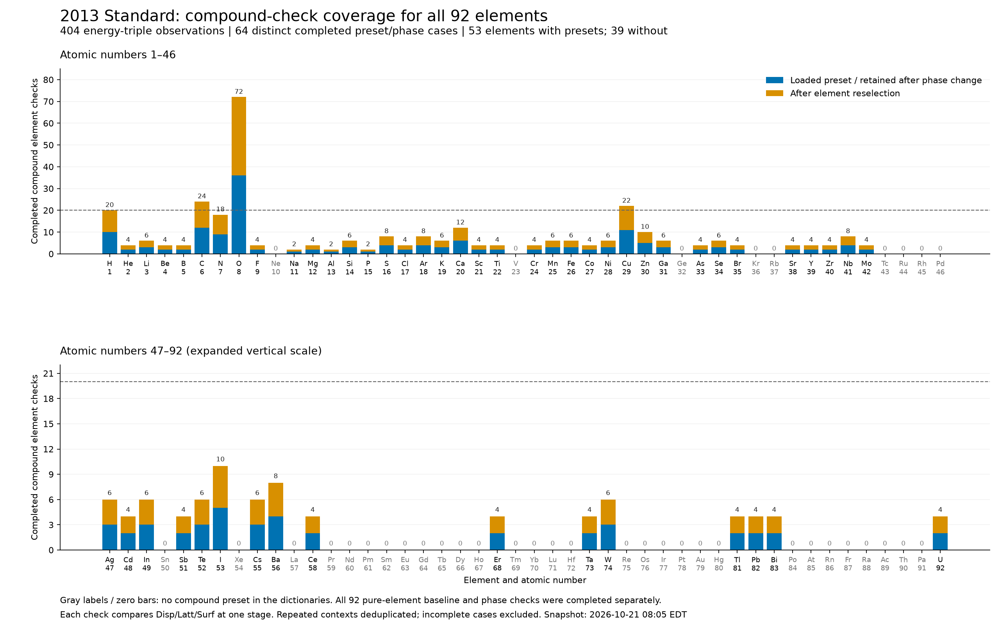

# TRIM elemental input defaults: findings of 2026-10-21

[Documentation index](../README.md) · [Native validation](validation.md#trim-native-checks) · [Machine-readable table](trim-elemental-defaults.csv)

This investigation concerns the **displayed TIN input defaults** for displacement energy (Disp), lattice binding energy (Latt) and surface binding energy (Surf). It does not establish physically correct parameters for a particular material or validate transport results. The installed versions inspected were `srim_2008`, `srim_2013_std` and `srim_2013_pro` under `D:/local/srim/`.

## Main conclusion and boundaries

One element-indexed **3 × 92 default table** reproduces all measured pure-element baselines across the three installations. The table below is transposed for readability: one element per row, with three default-energy columns. All 92 elements also completed solid/gas checkbox, fresh-reselection and phase-restoration checks in each version; no default-energy difference was observed. One Standard titanium attempt failed an identity check and its separately retained retry passed.

Completed compound captures agree with the constituent elemental defaults. The final Standard-only dataset contains 64 distinct completed preset/phase contexts and 404 retained/fresh element observations, with no energy discrepancy. This covers every element represented in the compound dictionaries, but not every preset or possible context. Full mode, random-mixture, incident-ion and compound matrices remain unfinished. A single table is therefore an evidence-supported default model, not an exhaustive proof of independence from every input.

Use these as initial values; explicit user choices remain overrides. TRIM atom entries can represent the same element in different layers with different supplied energies, so element-based defaults must not collapse distinct target entries. This session added no production TRIM resource, request format or transport implementation.

## Meaning, units and documented basis

The three TRIM input energies are in eV. ATOMDATA's `Heat Subl` column is sublimation energy in **eV per atom**, not a molar-energy quantity. A numerical zero in that source column must not be interpreted as a measured zero surface barrier.

The [official input manual, Chapter 8](https://www.srim.org/SRIM/SRIM%2008.pdf) describes displacement as the energy threshold associated with moving an atom out of its lattice site, lattice binding as energy lost by a recoiling atom on leaving its site, and surface binding as the barrier for an atom leaving the surface. Page 8-5 identifies heat of sublimation as the solid surface-binding default. Its discussion of typical displacement values and material dependence is physical guidance, not a complete published algorithm for generating every default. The [official damage tutorial](https://www.srim.org/SRIM/Tutorials/SRIM%20Tutorial%204%20-%20Target%20Damage.pdf) gives the familiar silicon defaults 15/2/4.7 eV.

Final/cutoff energy is a separate parameter; a reference to a 2 eV final energy or silicon lattice energy does not document the surface-binding fallback.

## Lookup-equivalent reconstruction of the defaults

These rules match the complete measured table. They are an **empirical reconstruction**, not an inspection of native TIN source code or a claim that TIN executes these exact branches.

### Displacement

| Elements | Default Disp (eV) | Count |
| --- | ---: | ---: |
| He, Ne, Ar, Kr, Xe | 5 | 5 |
| H | 10 | 1 |
| Si, Ge | 15 | 2 |
| C, N, O | 28 | 3 |
| All remaining Z=1–92 | 25 | 81 |

There is no established first-principles calculation from atomic number in this investigation. These are exact observed exception sets. In particular, **Rn is not in the five-element 5 eV set**; replacing that set with a general “noble gases” category would give the wrong result.

### Lattice binding

| Elements | Default Latt (eV) | Count |
| --- | ---: | ---: |
| He, Ne, Ar, Kr, Xe | 1 | 5 |
| Si, Ge | 2 | 2 |
| All remaining Z=1–92 | 3 | 85 |

Again, these branches describe the observed lookup values. They are not a physical lattice-energy model for arbitrary compounds or phases.

### Surface binding and ATOMDATA

Let `s(Z)` be the tenth whitespace-delimited field of the numbered native ATOMDATA row, headed `Heat Subl`. For the installed files, all measured surface defaults satisfy:

\[
E_{\mathrm{surf}}(Z)=
\begin{cases}
s(Z), & s(Z)>0,\\
2\ \mathrm{eV}, & s(Z)=0.
\end{cases}
\]

All three installations have the same 92 sublimation-energy numbers: **72 positive entries match Surf directly; 20 zero entries correspond to Surf=2 eV**. The zero entries are H, He, N, O, F, Ne, Cl, Ar, Br, Kr, Tc, I, Xe, Pm, At, Rn, Fr, Ra, Ac and Pa. There are no other mismatches.

The manual supports using sublimation energy as the surface default. Online searches during this session did **not** locate an explicit authoritative statement of the general zero-to-2 eV branch. A [primary LiF simulation paper](https://link.springer.com/article/10.1140/epjc/s10052-026-15920-9) corroborates the specific library values Li=1.67 eV and F=2 eV; this is not documentation of the complete fallback algorithm. The general branch is supported here by all 92 measured defaults and all three installed ATOMDATA files.

No controlled ATOMDATA perturbation was performed. Numerical agreement does not prove whether TIN reads this field dynamically, caches it or embeds equivalent values. That causal question remains open. Negative or malformed sublimation entries were not tested; the rule above specifies only the observed nonnegative source data.

| Installed ATOMDATA | SHA-256 |
| --- | --- |
| 2008 | `42ce1a6a141da04ad4e3ae8cdfd887bc072514b96087ec08e2c006dc06764f02` |
| 2013 Standard | `44c8cfd5372b711ea3ca75493462c6339bfdaaa0b803c64de14ec4979369c91b` |
| 2013 Pro | `44c8cfd5372b711ea3ca75493462c6339bfdaaa0b803c64de14ec4979369c91b` |

The raw 2008 file spells row 37 `Ru Rubidium`; the comparison used the ordered atomic number, preserving source bytes. This is the existing compatibility issue described in [CAB validation](validation.md#cab-native-checks), not a change made by this investigation.

## Complete elemental table

The CSV has exactly 92 rows, ordered by `atomic_number` 1–92. Its numeric energy spellings are retained from the measured table/source data. The first three energy columns are the proposed default matrix; the final column is included to expose the zero fallback rather than silently replace source data. The CSV is research documentation, not a registered runtime resource.

| Z | Element | Disp (eV) | Latt (eV) | Surf (eV) | ATOMDATA sublimation (eV/atom) |
| ---: | --- | ---: | ---: | ---: | ---: |
| 1 | H | 10 | 3 | 2 | 0.00 |
| 2 | He | 5 | 1 | 2 | 0.00 |
| 3 | Li | 25 | 3 | 1.67 | 1.67 |
| 4 | Be | 25 | 3 | 3.38 | 3.38 |
| 5 | B | 25 | 3 | 5.73 | 5.73 |
| 6 | C | 28 | 3 | 7.41 | 7.41 |
| 7 | N | 28 | 3 | 2 | 0.00 |
| 8 | O | 28 | 3 | 2 | 0.00 |
| 9 | F | 25 | 3 | 2 | 0.00 |
| 10 | Ne | 5 | 1 | 2 | 0.00 |
| 11 | Na | 25 | 3 | 1.12 | 1.12 |
| 12 | Mg | 25 | 3 | 1.54 | 1.54 |
| 13 | Al | 25 | 3 | 3.36 | 3.36 |
| 14 | Si | 15 | 2 | 4.7 | 4.70 |
| 15 | P | 25 | 3 | 3.27 | 3.27 |
| 16 | S | 25 | 3 | 2.88 | 2.88 |
| 17 | Cl | 25 | 3 | 2 | 0.00 |
| 18 | Ar | 5 | 1 | 2 | 0.00 |
| 19 | K | 25 | 3 | 0.93 | 0.93 |
| 20 | Ca | 25 | 3 | 1.83 | 1.83 |
| 21 | Sc | 25 | 3 | 3.49 | 3.49 |
| 22 | Ti | 25 | 3 | 4.89 | 4.89 |
| 23 | V | 25 | 3 | 5.33 | 5.33 |
| 24 | Cr | 25 | 3 | 4.12 | 4.12 |
| 25 | Mn | 25 | 3 | 2.98 | 2.98 |
| 26 | Fe | 25 | 3 | 4.34 | 4.34 |
| 27 | Co | 25 | 3 | 4.43 | 4.43 |
| 28 | Ni | 25 | 3 | 4.46 | 4.46 |
| 29 | Cu | 25 | 3 | 3.52 | 3.52 |
| 30 | Zn | 25 | 3 | 1.35 | 1.35 |
| 31 | Ga | 25 | 3 | 2.82 | 2.82 |
| 32 | Ge | 15 | 2 | 3.88 | 3.88 |
| 33 | As | 25 | 3 | 1.26 | 1.26 |
| 34 | Se | 25 | 3 | 2.14 | 2.14 |
| 35 | Br | 25 | 3 | 2 | 0.00 |
| 36 | Kr | 5 | 1 | 2 | 0.00 |
| 37 | Rb | 25 | 3 | 0.86 | 0.86 |
| 38 | Sr | 25 | 3 | 1.7 | 1.70 |
| 39 | Y | 25 | 3 | 4.24 | 4.24 |
| 40 | Zr | 25 | 3 | 6.33 | 6.33 |
| 41 | Nb | 25 | 3 | 7.59 | 7.59 |
| 42 | Mo | 25 | 3 | 6.83 | 6.83 |
| 43 | Tc | 25 | 3 | 2 | 0.00 |
| 44 | Ru | 25 | 3 | 6.69 | 6.69 |
| 45 | Rh | 25 | 3 | 5.78 | 5.78 |
| 46 | Pd | 25 | 3 | 3.91 | 3.91 |
| 47 | Ag | 25 | 3 | 2.97 | 2.97 |
| 48 | Cd | 25 | 3 | 1.16 | 1.16 |
| 49 | In | 25 | 3 | 2.49 | 2.49 |
| 50 | Sn | 25 | 3 | 3.12 | 3.12 |
| 51 | Sb | 25 | 3 | 2.72 | 2.72 |
| 52 | Te | 25 | 3 | 2.02 | 2.02 |
| 53 | I | 25 | 3 | 2 | 0.00 |
| 54 | Xe | 5 | 1 | 2 | 0.00 |
| 55 | Cs | 25 | 3 | 0.81 | 0.81 |
| 56 | Ba | 25 | 3 | 1.84 | 1.84 |
| 57 | La | 25 | 3 | 4.42 | 4.42 |
| 58 | Ce | 25 | 3 | 4.23 | 4.23 |
| 59 | Pr | 25 | 3 | 3.71 | 3.71 |
| 60 | Nd | 25 | 3 | 3.28 | 3.28 |
| 61 | Pm | 25 | 3 | 2 | 0.00 |
| 62 | Sm | 25 | 3 | 2.16 | 2.16 |
| 63 | Eu | 25 | 3 | 1.85 | 1.85 |
| 64 | Gd | 25 | 3 | 3.57 | 3.57 |
| 65 | Tb | 25 | 3 | 3.81 | 3.81 |
| 66 | Dy | 25 | 3 | 2.89 | 2.89 |
| 67 | Ho | 25 | 3 | 3.05 | 3.05 |
| 68 | Er | 25 | 3 | 3.05 | 3.05 |
| 69 | Tm | 25 | 3 | 2.52 | 2.52 |
| 70 | Yb | 25 | 3 | 1.74 | 1.74 |
| 71 | Lu | 25 | 3 | 4.29 | 4.29 |
| 72 | Hf | 25 | 3 | 6.31 | 6.31 |
| 73 | Ta | 25 | 3 | 8.1 | 8.10 |
| 74 | W | 25 | 3 | 8.68 | 8.68 |
| 75 | Re | 25 | 3 | 8.09 | 8.09 |
| 76 | Os | 25 | 3 | 8.13 | 8.13 |
| 77 | Ir | 25 | 3 | 6.9 | 6.90 |
| 78 | Pt | 25 | 3 | 5.86 | 5.86 |
| 79 | Au | 25 | 3 | 3.8 | 3.80 |
| 80 | Hg | 25 | 3 | 0.64 | 0.64 |
| 81 | Tl | 25 | 3 | 1.88 | 1.88 |
| 82 | Pb | 25 | 3 | 2.03 | 2.03 |
| 83 | Bi | 25 | 3 | 2.17 | 2.17 |
| 84 | Po | 25 | 3 | 1.5 | 1.50 |
| 85 | At | 25 | 3 | 2 | 0.00 |
| 86 | Rn | 25 | 3 | 2 | 0.00 |
| 87 | Fr | 25 | 3 | 2 | 0.00 |
| 88 | Ra | 25 | 3 | 2 | 0.00 |
| 89 | Ac | 25 | 3 | 2 | 0.00 |
| 90 | Th | 25 | 3 | 5.93 | 5.93 |
| 91 | Pa | 25 | 3 | 2 | 0.00 |
| 92 | U | 25 | 3 | 5.42 | 5.42 |

## Compound loading and phase findings

The adopted policy is **one compound occupies the whole layer**, loaded into an initially empty target. Different layers may contain different elements or compounds.

Earlier order diagnostics found that entering Si first and then loading Air clears Si's identity but leaves a Z=0 row with stoichiometry 1. Loading Air into the empty layer and adding Si afterward produced filled element rows in all three versions, but the save attempts stopped at density warnings and left TRIM.IN unchanged. Those diagnostic mixtures are excluded from the whole-layer default comparisons. They do not establish how an exported input or transport simulation would handle the blank row.

TIN recalculates displayed atomic percentages from relative stoichiometries. Changing or adding a component changes the normalized percentages; a remaining blank row with nonzero stoichiometry can affect that display. Atomic-basis ratios and mass-basis preset conversion must remain distinguishable. Compound source compositions and bonds were not edited to manufacture coverage.

Liquid water presents a solid-chemistry stopping-correction prompt. The user manually selected Yes and reported H=10/3/2 and O=28/3/2 eV across all three versions, including phase changes. Subsequently approved automation reproduced the default and phase captures, validating the exact known prompt before selecting Yes. No inference about a numeric correction is made from its message, which omits the number. Later phase toggles test displayed energy defaults; they do not establish a physically correct phase-specific stopping correction.

## Final coverage and counting

The full original three-suite plan contains 9,232 GUI cases, including repeated baseline groups. The later remaining queue contained 8,404 planned cases before success-based skips. **Neither full plan completed.**

The broad queue was stopped on request after a 20-minute window, by 2026-10-21 07:25:37 EDT (deadline 07:25:33). Its accumulated snapshot had 207 completed cases, 22 incomplete finalized attempts and one interrupted case excluded from the counts. The 234 low-count observations audited at that cutoff had no missing fields, identity errors, source-span mismatches, loaded-to-fresh changes or energy differences.

The targeted plan initially covered all versions; the user then narrowed it to **2013 Standard only**. Fourteen Standard targeted cases had completed, 40 unfinished Standard cases were resumed and passed, and two additional Freon-12 default/phase checks closed the F/Cl gap exposed by changing to a Standard-only histogram: **56 Standard targeted cases, all complete**.

Together with earlier unique Standard smoke captures, this gives **64 distinct successful preset/phase contexts: 25 default and 39 phase cases**. Each retained or freshly reselected element's three-energy vector counts as one observation. Repeated captures of the same source preset/phase context are deduplicated; incomplete captures and manual-order diagnostics are excluded. The two stages are not independent statistical replicates.

The plot has **404 observations across 53 represented elements**. All 92 are shown; 39 have no compound preset in these dictionaries and therefore zero compound observations. Their pure-element baselines and phase checks were completed separately. Forty-nine represented elements still have fewer than 20 Standard compound observations. Narrowing to Standard reduces the count relative to a combined-version histogram; repeated successes were not used merely to force the count to 20. The two panels use different vertical scales, explicitly labeled.

All 404 retained/fresh rows passed the final field and identity audit. No loaded-to-fresh mass, stoichiometry or energy changes, source-byte errors, phase-state errors or energy discrepancies were found in these completed contexts. Runtime dictionary restoration and process cleanup passed, original installation hashes remained unchanged, and no copied TIN executable remained running at the final check.

## Automation and limitations

The three standalone entry scripts are local, ignored research tools under `.cache/trim-default-checks/`: `element_context.py`, `compound_defaults.py` and `phase_defaults.py`, sharing `common.py`. They create isolated runtimes, record raw UI controls/actions and popup observations, and close only owned executables. They do not launch TRIM transport for ordinary default captures.

The random-mixture matrix was generated for each Z=1–92 with one, two and three distinct companion elements; companion choices and integer proportions 1–100 use seed `20261021` and are identical across versions. The selected layer layouts are Si/C, C/Si and Si/O/Au. The incident-ion matrix is H/He/Ar/Au at 10/100/1000 keV. Supported modes are 1–7 for 2008 and 1–8 for 2013. These define approved coverage, not a claim all those cases ran. The 21 different-element-layer phase cases completed after a failed Standard capture was retried; the full remaining mode/mixture/ion matrices did not.

Stock-dictionary accessibility activation once selected a different material; its unexpected confirmation was recorded and rejected. Approved single-preset copies preserve exact original header, category, record/comments and final end marker. Exact-byte extraction/restoration checks passed for all 1,059 presets (345/357/357), without native launching during that byte check. Omitting the final marker initially caused an end-of-file error. Native successes describe **isolated preset contexts**, not proven equivalence with stock-dictionary interaction.

Other incomplete cases include foreground ownership failures, wrong identities during fresh reselection, and confirmation-text differences such as W&W becoming WW in captured text. These are unresolved capture/interface issues, not established scientific discrepancies. Unknown prompts remain unhandled. A popup monitor can miss a sufficiently brief event; forced stop can prevent the in-flight case from writing its normal final record, so external cleanup/restoration evidence and incomplete coverage are retained.

The approved resume option skips only complete, warning-free, cleaned-up exact case dictionaries with matching installed source hashes and successful dictionary restoration. The explicit known-chemistry option validates the exact message/title/stage/button layout and records its Yes decision. Neither option authorizes responses to arbitrary warnings.

## Retained evidence and next work

Raw local evidence is ignored by Git and is not guaranteed to survive cache cleanup. This document, CSV and figure preserve the numerical findings independently of that cache. The [validation reference](validation.md#trim-native-checks) summarizes later execution coverage. Original investigation notes and evidence paths are preserved in the local documentation migration archive.

Unfinished work is the full mode, mixture, ion, compound and compound-phase coverage, plus resolution of incomplete captures. Testing whether changing ATOMDATA actually changes TIN defaults would establish causality; it has not been performed. Any production integration or native-behavior amendment still needs its own design and verification. Preserve explicit per-entry user overrides rather than treating the measured defaults as universal physical values.
